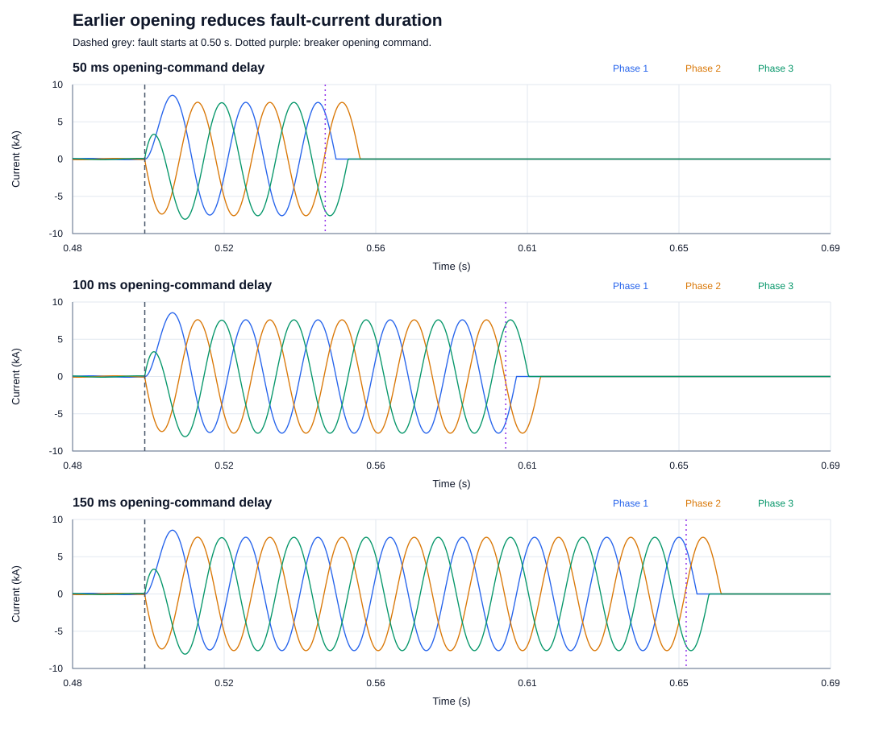
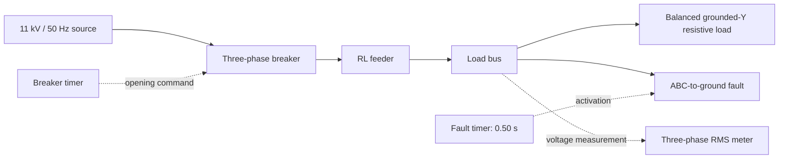
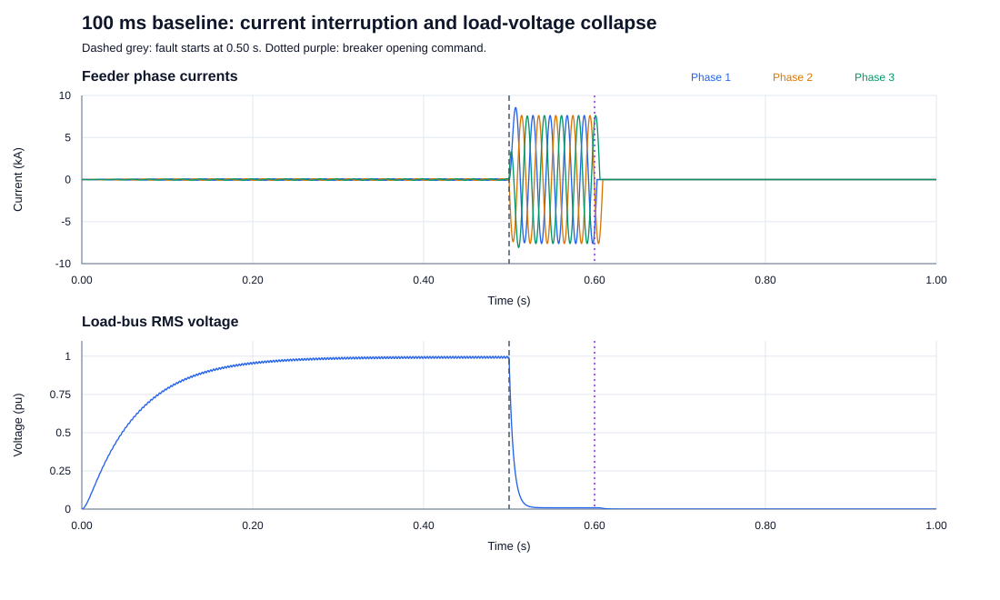

# Three-Phase Network Faults and Circuit-Breaker Clearing in PSCAD

A beginner power-systems study of an 11 kV feeder: what happens to current and load voltage during a three-phase-to-ground fault, and how does breaker opening-command delay affect current exposure?

**Main finding:** reducing the opening-command delay from 150 ms to 50 ms reduced average per-phase I²t by **64.3%**, while the largest sampled current peak remained **8.562 kA**. Earlier opening reduces how long the current flows; it does not remove the initial fault peak.



## Network



Voltage is the electrical push; current is the flow. A fault introduces an unwanted low-resistance path. The breaker interrupts the supply to that path and also disconnects the load. Load voltage therefore stays near zero after interruption.

## Model assumptions

| Item | Setting |
|---|---|
| Supply | 11 kV line-to-line RMS, 50 Hz; 0° phase setting |
| Source impedance | 0.2 Ω resistance per phase; no separate zero-sequence branch |
| Supply startup | First-order ramp, 0.06 s time constant |
| Feeder | 0.5 Ω and 3 mH in series per phase; capacitance disabled |
| Load | Grounded Y; 100 Ω per phase; resistive only |
| Breaker | 0.001 Ω closed; 1 MΩ open; common command for all phases |
| Breaker interruption | Current-dependent opening; 0.001 kA chopping threshold |
| Fault | ABC-to-ground; 0.01 Ω ON, 1 MΩ OFF |
| Fault timing | Starts at 0.50 s; duration 1.0 s (beyond simulation end) |
| Voltage measurement | Analog three-phase RMS, 11 kV base, 5 ms smoothing |
| Simulation | 1 s duration; 50 µs solution step; 250 µs export interval |

These are fictional teaching values. This is a lumped feeder and idealised switching study, not a model of an AEMO, Transgrid, Ausgrid or Essential Energy asset. It does not include an automatic protection relay, detailed arc behaviour, line geometry, mutual coupling or a compliance assessment.

## Measured results

| Opening-command delay after fault | Command time | Largest sampled peak | Mean per-phase I²t |
|---|---|---|---|
| 50 ms | 0.55 s | 8.562 kA | 1.603 kA²s |
| 100 ms | 0.60 s | 8.562 kA | 3.050 kA²s |
| 150 ms | 0.65 s | 8.562 kA | 4.497 kA²s |

I²t is integrated over the same 0.50–0.70 s window in every case, then averaged across phases. It is a current-exposure measure, not a temperature prediction. Opening-command time is distinct from actual current interruption: phases interrupt near different current zeros.

For the 100 ms baseline, normal current is approximately **63.05 A RMS**, sustained fault current **5.379 kA RMS**, and pre-fault load voltage **0.993 pu**. The final phase falls below 1 A between **0.60950 and 0.60975 s**, based on exported samples.



The voltage drop at 0.50 s is caused by the fault. The initial voltage rise is the configured source startup; the rounded voltage collapse includes the meter's smoothing response.

## Validation

- Hand calculations predict approximately 63.1 A normal current and 5.38 kA symmetrical fault RMS current. See [calculations and methods](docs/methodology.md).
- In the 100 ms case, halving the solution step from 50 to 25 µs changed the largest sampled peak by **0.012%** and mean per-phase I²t by **0.033%**. The exported threshold-crossing intervals remained unchanged at 250 µs sampling resolution.
- This is a two-step numerical sensitivity check for this case and these metrics, not full validation against a real network or proof of convergence for every transient.

## Open and reproduce

1. Use PSCAD with its Master Library and a working supported compiler. The supplied project was saved in **PSCAD Free 5.1.0**; it uses Master Library components only. Other versions have not been tested.
2. Open [`model/ThreePhaseFaultStudy.pscx`](model/ThreePhaseFaultStudy.pscx).
3. The saved baseline has fault inception at 0.50 s and breaker command at 0.60 s. Build and run for 1 second.
4. Change only **Timed Breaker Logic → Time of First Breaker Operation** to 0.55, 0.60 or 0.65 s for the delay cases. Keep the fault active beyond the run.
5. Export each current and voltage graph with **Copy Data to Clipboard → All**. Preserve the original exports; their current columns have repeated `I_Feeder` headings.
6. To reproduce numerical analysis and figures, install Python 3.10+ and run:

   ```text
   python scripts/analyze.py
   ```

   No additional Python packages are needed. The script reads all seven CSV exports, checks their shape and sample spacing, and writes metrics, static SVG charts, comparison text and source checksums to `results/`.

The native project was run interactively in PSCAD by the project author. Repository preparation checked its saved settings and recalculated results from the provided exports; it did not independently execute the packaged model in PSCAD.

## Repository contents

- `model/`: saved baseline PSCAD case; generated compiler files are excluded.
- `data/`: seven exported datasets: three current cases, three voltage cases and the 25 µs current sensitivity case.
- `scripts/analyze.py`: reproducible analysis and chart generation.
- `results/`: figures, numeric metrics, comparison and source SHA-256 hashes.
- `docs/`: calculation method, beginner walkthrough, interview notes and GitHub upload guide.

## Learning and next extensions

Skills practised: three-phase EMT modelling, grounded-Y loads, timed switching, fault-current calculations, per-unit voltage, current-zero interruption, CSV analysis and time-step sensitivity.

Possible future extensions (not implemented): single-phase-to-ground faults with explicitly justified sequence impedances; fault-resistance sensitivity; automatic overcurrent relay logic; more detailed source and feeder models.

Built as a guided learning project with AI assistance. The model settings, exported results and analysis method are included so the study can be checked and reproduced.

## References

- [PSCAD: Three-Phase Voltage Source Model 1](https://www.pscad.com/webhelp/Master_Library_Models/Sources/Voltage_Source_Model_1/3p_source.htm)
- [PSCAD: Three-Phase Breaker](https://www.pscad.com/webhelp/Master_Library_Models/Breakers/3p_break.htm)
- [PSCAD: Three-Phase Fault](https://pscad.com/webhelp-v502-ol/Master_Library_Models/Breakers_And_Faults/Faults/3p_fault.htm)
- [PSCAD: Runtime Configurable Passive Branch](https://www.pscad.com/webhelp/Master_Library_Models/Passive/Runtime_Configurable_Passive_Branch.htm)
- [PSCAD: Three-Phase RMS Voltmeter](https://pscad.com/webhelp-v502-ol/Master_Library_Models/Meters/3p_voltmeter.htm)
